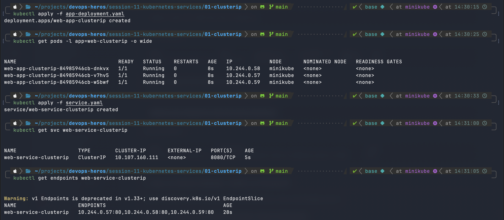
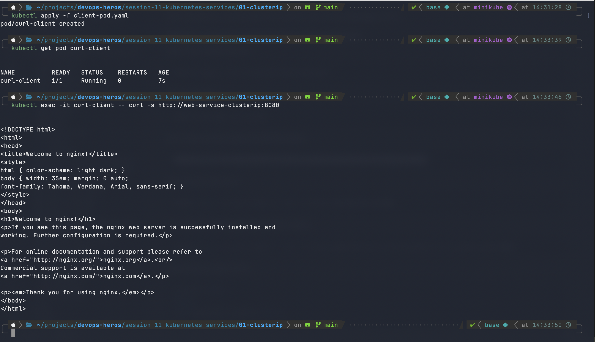
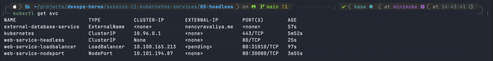

# Session 11: Kubernetes Networking & Services

This session demonstrates all 5 Kubernetes Service types, in-depth object comparisons, Fully Qualified Domain Name (FQDN) resolution, and CoreDNS service discovery.

---

## Task 1: Kubernetes Services Demonstration

### 1. ClusterIP Service
ClusterIP is the default service type, providing a stable internal IP address accessible only from within the cluster.

*Figure 1: `kubectl get svc` and endpoint verification for ClusterIP service.*

*Figure 2: Verifying internal cluster communication and port mapping.*

### 2. NodePort, LoadBalancer, ExternalName & Headless
- **NodePort**: Exposes the service on each Node's IP at a static port (30000–32767).
- **LoadBalancer**: Provisions an external cloud load balancer (e.g. AWS NLB/ALB) forwarding to NodePort.
- **ExternalName**: Maps the service to an external DNS name via CNAME record (no proxying).
- **Headless**: Set `clusterIP: None` to return individual Pod IPs for direct StatefulSet routing.

*Figure 3: Multi-service deployment and active endpoint status.*

---

## Task 2: Kubernetes Object Comparisons

### 1. Deployment vs ReplicaSet
- **Purpose**: A ReplicaSet ensures that a specified number of Pod replicas are running at all times. A Deployment is a higher-level controller that manages ReplicaSets to provide declarative updates (rolling updates, rollbacks).
- **Pod Management**: Deployments create and manage underlying ReplicaSets. Users interact with Deployments; Kubernetes manages the ReplicaSets automatically.
- **Scaling**: Both can scale pods, but Deployments provide declarative scaling and version history.
- **Rolling Updates**: ReplicaSets cannot perform automated rolling updates. Deployments orchestrate zero-downtime updates by creating a new ReplicaSet and gradually scaling it up while scaling down the old one.

### 2. Deployment vs DaemonSet vs StatefulSet
| Feature | Deployment | DaemonSet | StatefulSet |
| :--- | :--- | :--- | :--- |
| **Use Case** | Stateless web apps & APIs | Cluster node agents (Fluentd, kube-proxy) | Stateful databases (PostgreSQL, Kafka) |
| **Pod Placement** | Any worker node (via scheduler) | Exactly one Pod per node across cluster | Specific nodes with stable network IDs |
| **Pod Identity** | Random hashes (`web-7d48f-x9kz2`) | Node-tied hashes (`fluentd-abc12`) | Ordered, persistent (`db-0`, `db-1`) |
| **Storage** | Ephemeral or shared PVC | Host path mounts | Dedicated PVC per Pod (`volumeClaimTemplates`) |
| **Scaling** | Arbitrary parallel scale-up/down | Matches cluster node count automatically | Ordered scaling (0 -> 1 -> 2) |

### 3. ReplicaSet vs Service
- **ReplicaSet Responsibility**: Manages pod lifecycle, self-healing, replica count, and health.
- **Service Responsibility**: Provides a stable network endpoint, DNS name, and load balances traffic across pods.
- **Why Service is Required**: Pod IPs are ephemeral and change upon restart/reschedule. A Service gives a permanent IP/DNS abstraction.
- **Traffic Routing**: Services use label selectors matching Pod labels. `kube-proxy` configures iptables/IPVS rules to route incoming traffic directly to healthy Pod IPs.

---

## Task 3 & 4: FQDN & CoreDNS Documentation

- [FQDN Deep Dive & Examples](fqdn/README.md)
- [CoreDNS Architecture & Troubleshooting](coredns/README.md)

---

## Manifest Directories
- `01-clusterip/` - ClusterIP deployment & service YAMLs
- `02-nodeport/` - NodePort deployment & service YAMLs
- `03-loadbalancer/` - LoadBalancer service YAMLs
- `04-externalname/` - ExternalName CNAME service YAMLs
- `05-headless/` - Headless StatefulSet service YAMLs
